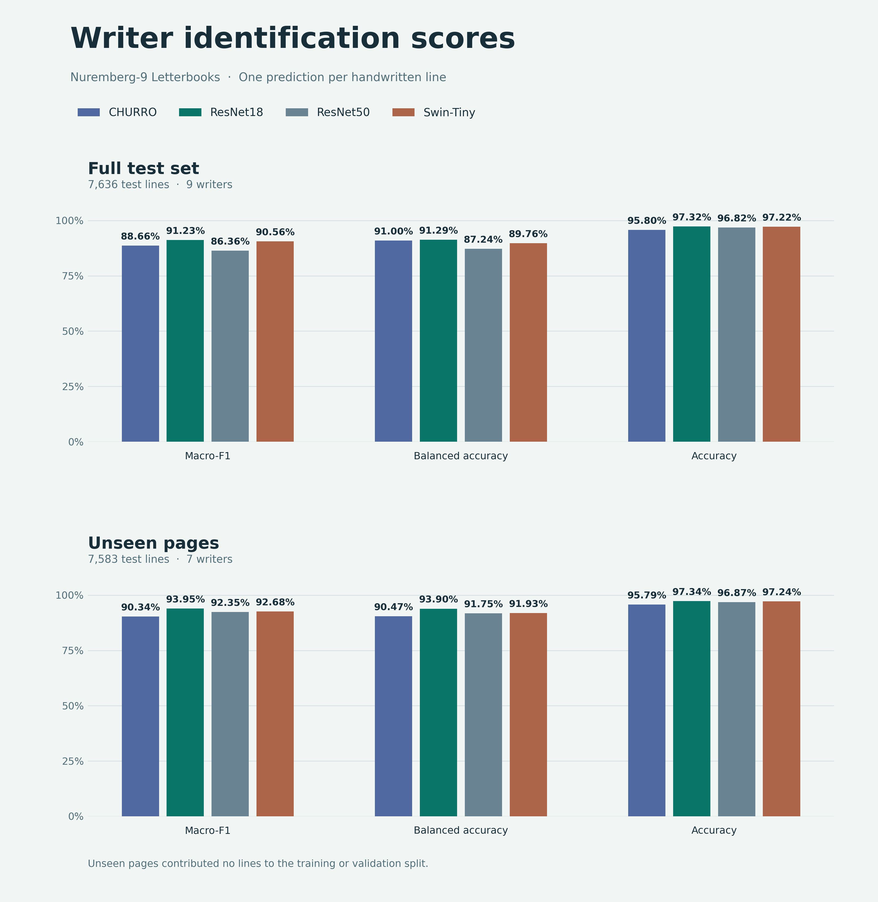
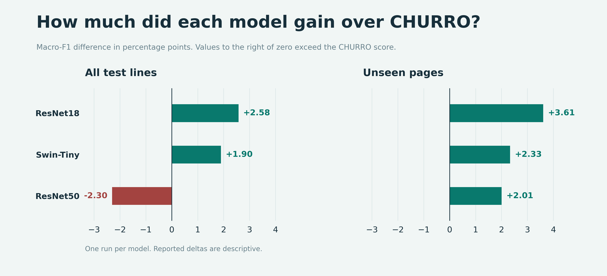
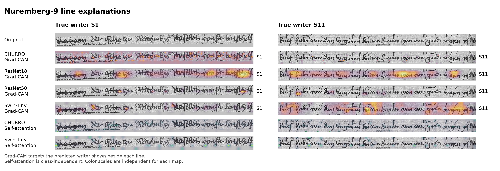

# Nuremberg-9 model comparison

Whole-line writer identification on Nuremberg Letterbooks with CHURRO, ResNet18, ResNet50 and Swin-Tiny. All four were evaluated on the same 7,636 test lines. The CHURRO visual encoder was frozen and only its classifier was trained. The three ImageNet-initialized baselines were fine-tuned on Nuremberg.

[All vertical figures](reports/comparison/) · [Original Macro-F1 overview](reports/comparison/metrics/macro_f1_overview.png)

**ResNet18 led this run**, with 91.23% macro-F1 on the nine-writer test and a 2.58 percentage-point gain over CHURRO. It also led on the subset of pages absent from training and validation.

[Macro-F1 overview (SVG)](reports/comparison/metrics/macro_f1_overview.svg) · [CHURRO-relative differences (PNG)](reports/comparison/metrics/difference_from_churro.png) · [CHURRO-relative differences (SVG)](reports/comparison/metrics/difference_from_churro.svg)

## Scores and diagnostics

| Model | Macro-F1 | Balanced accuracy | Accuracy |
|---|---:|---:|---:|
| ResNet18 | 91.23% | 91.29% | 97.32% |
| Swin-Tiny | 90.56% | 89.76% | 97.22% |
| CHURRO | 88.66% | 91.00% | 95.80% |
| ResNet50 | 86.36% | 87.24% | 96.82% |

The unseen-page subset has 7,583 test lines and seven writers. S11 and S12 have 14 and 7 lines in the full test and share some pages with the training or validation split. The subset excludes those writers because it excludes all pages seen during training or validation.

Unseen-page results

| Model | Macro-F1 | Balanced accuracy | Accuracy |
|---|---:|---:|---:|
| ResNet18 | 93.95% | 93.90% | 97.34% |
| Swin-Tiny | 92.68% | 91.93% | 97.24% |
| ResNet50 | 92.35% | 91.75% | 96.87% |
| CHURRO | 90.34% | 90.47% | 95.79% |

[Full scores and sample counts](reports/comparison/metrics/scores.json) · [Full test table](reports/comparison/metrics/test_scores.svg) · [Unseen-page table](reports/comparison/metrics/test_scores_unseen_pages.svg) · [Per-writer recall](reports/comparison/metrics/recall_per_scribe.svg) · [Confusion matrices](reports/comparison/metrics/confusion.svg)

## Model outputs and explanation galleries

All four models show Grad-CAM for their predicted class. CHURRO and Swin-Tiny also show received self-attention. The galleries use the same selected test lines.

| Model | Training and scores | 27-line gallery |
|---|---|---|
| CHURRO | [Fit and predictions](reports/churro/fit/) | [Gallery](reports/churro/explanations/) |
| ResNet18 | [Fit and predictions](reports/resnet18/fit/) | [Gallery](reports/resnet18/explanations/) |
| ResNet50 | [Fit and predictions](reports/resnet50/fit/) | [Gallery](reports/resnet50/explanations/) |
| Swin-Tiny | [Fit and predictions](reports/swin_tiny/fit/) | [Gallery](reports/swin_tiny/explanations/) |

[Side-by-side gallery](reports/comparison/explanations/) · [Selected test lines](reports/comparison/selected_lines.csv) · [Run logs](run-logs/)

[Download the three fine-tuned checkpoints](https://github.com/emresulutas/nuremberg9-model-comparison/releases/download/v1.0.0/training-checkpoints.zip) · [Download all raw explanation maps](https://github.com/emresulutas/nuremberg9-model-comparison/releases/download/v1.0.0/explanation-maps.zip)

## Code and data

[Experiment and reproduction commands](nuremberg-9/experiments/05_model_comparison/) · [Training runner](nuremberg-9/scripts/run_model_comparison.sh) · [Split manifests](splits/) · [Dataset setup](datasets/)

The archived CHURRO head and predictions are reused by the runner. The historical CHURRO training script also references the earlier seven-writer project.

The dataset is [Nuremberg Letterbooks by Mayr et al.](https://zenodo.org/records/13881575), licensed under [CC BY 4.0](https://creativecommons.org/licenses/by/4.0/). The images in the explanation figures and arrays are masked grayscale line crops with heatmap overlays. Model initialization sources are [CHURRO-3B](https://huggingface.co/stanford-oval/churro-3B), [Torchvision ResNet weights](https://docs.pytorch.org/vision/stable/models.html) and [Swin-Tiny ImageNet-1k](https://huggingface.co/timm/swin_tiny_patch4_window7_224.ms_in1k). The original CHURRO backbone is available from its upstream model page.
