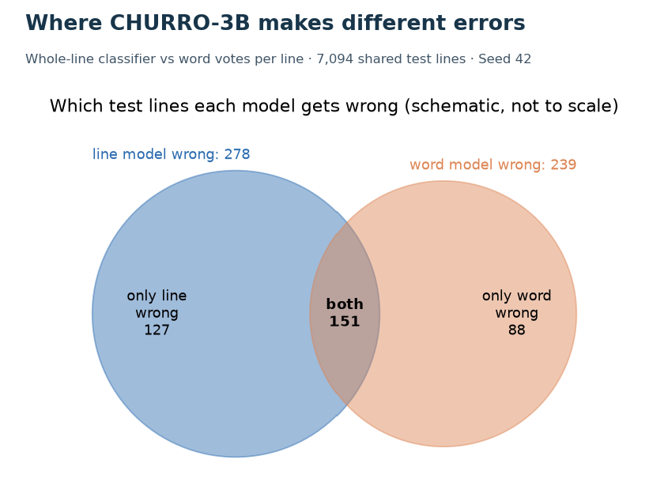

# Error Overlap · CHURRO-3B whole lines vs word voting

Both classifiers use block 16 of the frozen CHURRO-3B visual encoder. The Balanced Probe classifier predicts directly from a whole line. The Word vs Line classifier predicts each word and averages the log-probabilities for the line.

The seed-42 comparison covers 7,094 shared test lines that could be split into words. Only the whole-line classifier was wrong on 127 lines, only the word-vote classifier on 88 lines, and both on 151 lines.

| Result | Files |
|---|---|
| Error counts and overlaps | [Table](overlap_table.png) · [Metrics and seed comparisons](overlap.json) |
| Accuracy by writer, word count and confidence | [Chart](by_line_type.png) · [CSV](by_line_type.csv) |
| Ensemble performance | [Score comparison](ensemble/compare_bars.png) · [CSV](ensemble/ensemble_summary.csv) · [Metrics](ensemble.json) |
| Ensemble details | [Weight sweep](ensemble/weight_curve.png) · [Recall by writer](ensemble/per_scribe_recall.png) · [Errors fixed or introduced](ensemble/fixed_vs_broken.png) |

The ensemble combines whole-line and word-vote scores across 15 seed pairs. Each tuned weight is selected on validation before testing.
