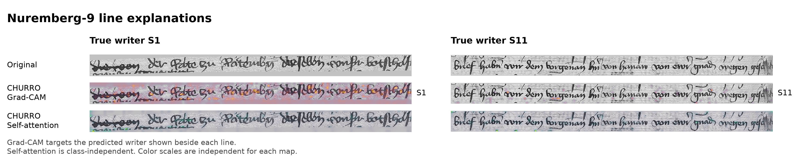

# CHURRO whole-line reference

The frozen CHURRO block-16 classifier scored **88.66% macro-F1**, **91.00% balanced accuracy**, and **95.80% accuracy** on 7,636 test lines from nine writers. These are the [saved scores from the whole-line run](../../01_balanced_probe/results/weighted_oversample/summary.json).

The [shared test selection](selected_lines.csv) contains three lines per writer, sampled with seed 42 without using the model predictions. The panel shows two of those lines, `r3l35` from writer S1 and `r1l17` from writer S11. The four-model comparison uses the same selection for its explanation galleries. See the [comparison protocol](../README.md).

The source images are from the Nuremberg Letterbooks dataset by Mayr et al. The figure crops the source images to lines, converts them to grayscale, and adds the heatmap overlays. [Dataset record](https://zenodo.org/records/13881575) · [CC BY 4.0 license](https://creativecommons.org/licenses/by/4.0/)
