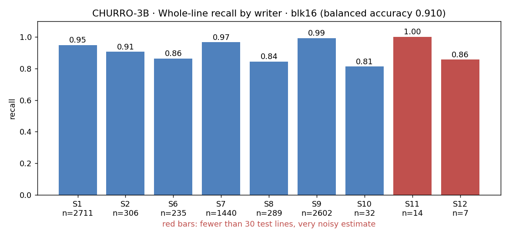

# CHURRO-3B

We froze the visual encoder and trained a linear classifier on whole-line features from block 16. This block was selected in the earlier seven-writer validation study. The nine-writer run used class weighting and oversampling to give rare writers more representation.

Square-root oversampling increased how often rare writers appeared during training. Effective-number weights were computed after sampling so that the two corrections would not both use the original class frequencies. Those two choices were made together. The nine-writer study did not estimate their separate effects.

## Experiments

| Experiment | Why we ran it | What it showed | Files |
|---|---|---|---|
| Balanced Probe | Could frozen CHURRO features distinguish nine writers with uneven class sizes? | The whole-line classifier reached 88.66% Macro-F1 on 7,636 test lines. | [Training curves](training-curves.png) · [Confusion matrix](test-confusion-matrix.png) |
| Augmentation | Would additional copies of rare writers' training lines help? | Across five seeds, Macro-F1 rose from 88.2% to 89.2% and balanced accuracy fell from 90.5% to 90.0%. The reference run uses the original lines. | [Augmentation](augmentation.png) |
| Word vs Line | Did word crops or whole lines give better writer predictions? | Word voting reached 90.7% Macro-F1 and whole lines 90.0% on the same 7,094 lines in the seed-42 run. | [Word vs Line](word-vs-line.png) |
| Error Overlap | Did the whole-line classifier and word voting fail on the same lines? | Only the whole-line classifier missed 127 lines, only word voting missed 88, and both missed 151. | [Error overlap](error-overlap.png) · [Word and line ensemble](word-line-ensemble.png) |

[Grad-CAM and attention example](grad-cam-and-attention.png)

## Whole-line diagnostic figures

The three charts use the same 7,583 lines from pages excluded from training and validation.

- [Precision, recall and F1 by writer](line-scores-by-writer.png) shows who was identified well. Sample counts are under each writer. [Writer scores for both test sets](line-scores-by-writer.csv)
- [Most frequent writer confusions](common-line-errors.png) shows where the errors went. The largest was S1 predicted as S8 on 43 lines.
- [Confidence and page variation](line-confidence-and-pages.png) shows how accuracy changes across probability ranges and pages. The model made 84 errors with at least 95% predicted confidence. Probability here is the model's raw score.
