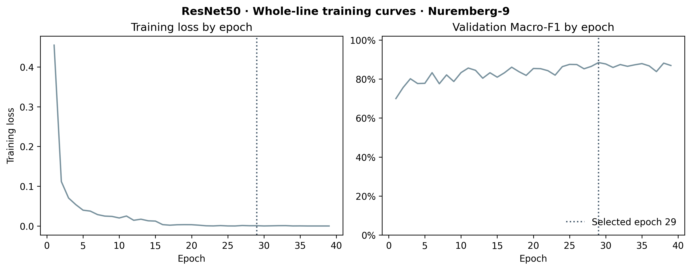

# ResNet50

A residual CNN with 50 layers. It provides a deeper residual baseline under the same data split and training protocol.

The model received a masked grayscale image of a whole line. Its weights were fine-tuned from ImageNet initialization. The checkpoint was selected by validation Macro-F1.

[Shared training and test conditions](../../02-model-comparison/README.md)

| Model | Macro-F1 | Balanced accuracy | Accuracy |
|---|---:|---:|---:|
| ResNet50 | 86.36% | 87.24% | 96.82% |

[Full-test recall by writer](test-recall.png)

[Test confusion matrix](test-confusion-matrix.png)

[Grad-CAM example on a shared test line](grad-cam.png)

## Whole-line diagnostic figures

The three charts use the same 7,583 lines from pages excluded from training and validation.

- [Precision, recall and F1 by writer](line-scores-by-writer.png) shows who was identified well. Sample counts are under each writer. [Writer scores for both test sets](line-scores-by-writer.csv)
- [Most frequent writer confusions](common-line-errors.png) shows where the errors went. The largest was S7 predicted as S1 on 38 lines.
- [Confidence and page variation](line-confidence-and-pages.png) shows how accuracy changes across probability ranges and pages. The model made 115 errors with at least 95% predicted confidence. Probability here is the model's raw score.
