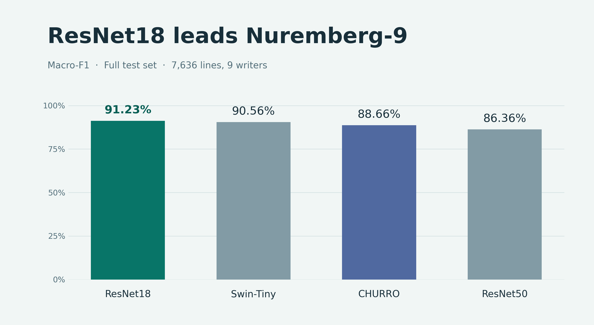

# Four-model comparison

The four trained classifiers were compared on the same masked whole lines. Each gives one writer prediction per line. The whole-line protocol avoids restricting the comparison to lines whose words could be segmented.

Macro-F1 averages F1 across writers, which gives rare writers the same weight as common writers. The held-out-page subset excludes pages used in training or validation.

All four runs use the same train, validation and test split, class weighting and square-root sampling. The ImageNet-initialized baselines fine-tune their encoders. CHURRO trains a linear classifier on frozen block-16 features. The checkpoint for each run is selected on validation Macro-F1.

The frozen CHURRO probe and the fine-tuned Swin-Tiny are different training setups. Their scores compare the resulting classifiers. They do not isolate the effects of architecture, pretraining or fine-tuning.

## All 7,636 test lines · nine writers

| Model | Macro-F1 | Balanced accuracy | Accuracy |
|---|---:|---:|---:|
| ResNet18 | 91.23% | 91.29% | 97.32% |
| Swin-Tiny | 90.56% | 89.76% | 97.22% |
| CHURRO-3B | 88.66% | 91.00% | 95.80% |
| ResNet50 | 86.36% | 87.24% | 96.82% |

## 7,583 lines from unseen pages · seven writers

| Model | Macro-F1 | Balanced accuracy | Accuracy |
|---|---:|---:|---:|
| ResNet18 | 93.95% | 93.90% | 97.34% |
| Swin-Tiny | 92.68% | 91.93% | 97.24% |
| ResNet50 | 92.35% | 91.75% | 96.87% |
| CHURRO-3B | 90.34% | 90.47% | 95.79% |

[Scores across both test sets](both-test-sets.png)

[Confusion matrices](confusion-matrices.png)

[Shared Grad-CAM and attention panel](grad-cam-and-attention.png)

[Scores CSV](scores.csv)

All four classifiers were trained with nine target labels. The unseen-page test excludes every page that supplied any training or validation line. This removed all 14 S11 lines, all 7 S12 lines, and 32 lines from other writers. The seven represented labels are used for Macro-F1 on this subset. The models can still predict any of the nine labels.

## Whole-line error analysis

- [F1 by writer for all four models](line-models-by-writer.png)
- [Shared and single-model errors at a glance](line-model-error-overlap.png) · [All exact intersections for both test sets](line-model-error-overlap.csv)
- [Every shared error group by model name](shared-error-intersections.png)
- [Find the actual lines and each model's predicted writer](line-error-cases.csv)

On unseen pages, 84 lines were misclassified by all four models and 7,077 were correctly classified by all four. The figure also shows lines that only one model got right. The counts describe complementary predictions from the four existing classifiers.
