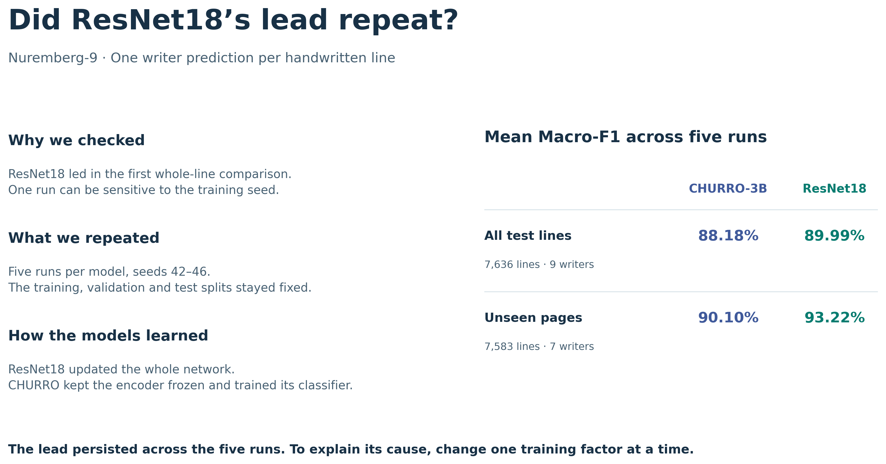
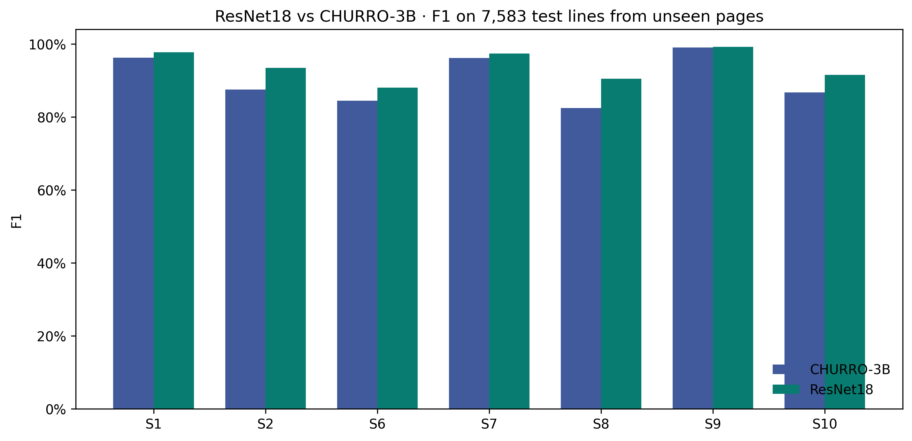
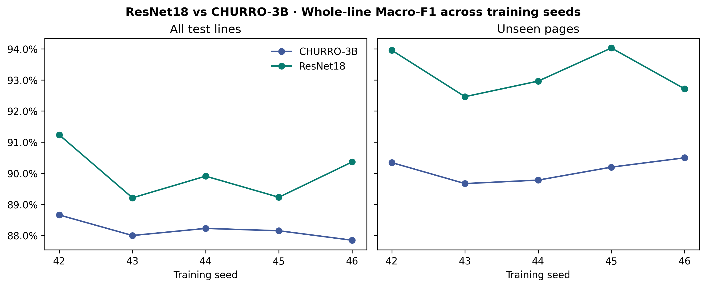

# ResNet18 vs CHURRO-3B

ResNet18 led the first whole-line comparison. We asked whether it would still lead after repeating training, and which writers and lines accounted for the first-run difference.

Both models kept the same train, validation and test splits and made one writer prediction per whole line. CHURRO used frozen visual features and a linear head. ResNet18 was fine-tuned end to end. The repeat changes the training seed. Measuring the effect of an individual training choice would require a separate controlled experiment.

## Original runs · seed 42

| Model | Macro-F1 | Balanced accuracy | Accuracy |
|---|---:|---:|---:|
| CHURRO-3B | 90.34% | 90.47% | 95.79% |
| ResNet18 | 93.95% | 93.90% | 97.34% |

[Both test sets in CSV](scores.csv)

On the same unseen-page lines, only ResNet18 was correct on 198 lines and only CHURRO-3B was correct on 81 lines. Predictions were aligned by page and line ID.

[Prediction disagreements and shared errors](which-model-was-correct.png)

## Repeated training · seeds 42–46

| Test set | Model | Runs | Mean Macro-F1 | Sample standard deviation |
|---|---|---:|---:|---:|
| All test lines | CHURRO-3B | 5 | 88.18% | 0.31% |
| All test lines | ResNet18 | 5 | 89.99% | 0.85% |
| Unseen pages | CHURRO-3B | 5 | 90.10% | 0.36% |
| Unseen pages | ResNet18 | 5 | 93.22% | 0.72% |

[Metrics for each seed](scores-by-seed.json)
