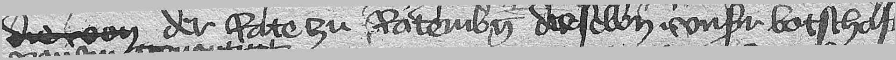
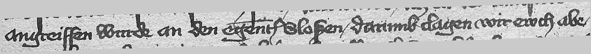
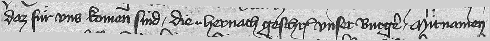
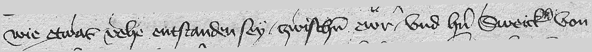
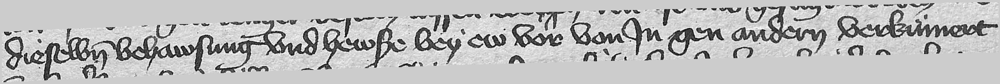
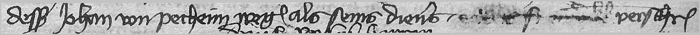
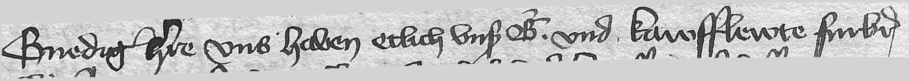
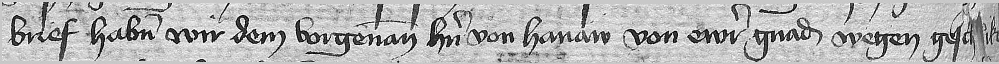
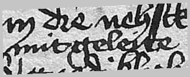

# Nuremberg-9 · Yazar başına bir örnek satır

Bunlar model girdisi olarak kullanılan gerçek, maskelenmiş test satırları. Her yazar için açıklama galerisinden bir örnek seçildi. Uygun olduğunda eğitim ve doğrulamada görülmemiş sayfalar tercih edildi.

S11 ve S12 örneklerinin sayfaları veri bölümleri arasında ortak. Tek bir satır, yazarın el yazısındaki bütün çeşitliliği kapsamaz.

## S1

Sayfa: Band2/Rst Nbg-Briefbücher-Nr 2_0022_left · Satır: r3l35

## S2

Sayfa: Band2/Rst Nbg-Briefbücher-Nr 2_0124_right · Satır: r3l22

## S6

Sayfa: Band2/Rst Nbg-Briefbücher-Nr 2_0056_right · Satır: r1l3

## S7

Sayfa: Band2/Rst Nbg-Briefbücher-Nr 2_0105_right · Satır: r2l15

## S8

Sayfa: Band3/Rst Nbg-Briefbücher-Nr 3_0128_right · Satır: r1l9

## S9

Sayfa: Band4/Rst Nbg-Briefbücher-Nr 4_0083_right · Satır: r2l11

## S10

Sayfa: Band5/Rst Nbg-Briefbücher-Nr 5_0209_left · Satır: r1l24

## S11

Sayfa: Band5/Rst Nbg-Briefbücher-Nr 5_0304_left · Satır: r1l17

## S12

Sayfa: Band5/Rst Nbg-Briefbücher-Nr 5_0082_left · Satır: line_1577035845443_3517
