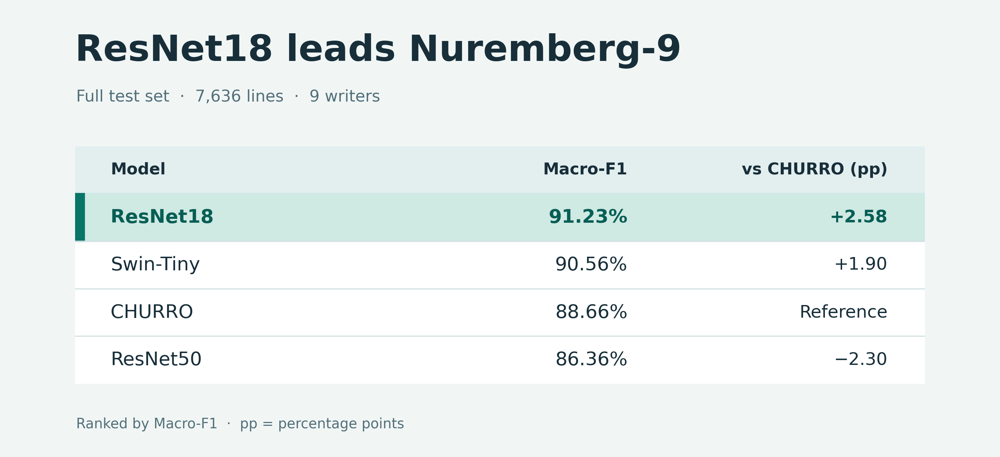

# Comparison figures

| Figure | Open |
|---|---|
| Model scores on the full test and unseen pages | [PNG](01-model-scores-vertical.png) |
| Percentage-point differences from CHURRO | [PNG](02-churro-differences-vertical.png) |
| Recall and test sample size for each writer | [PNG](03-writer-recall-vertical.png) |

[Score tables and original overview](metrics/) · [Explanation gallery](explanations/) · [Source code for the vertical charts](../../nuremberg-9/experiments/05_model_comparison/plot_vertical_comparison.py)
